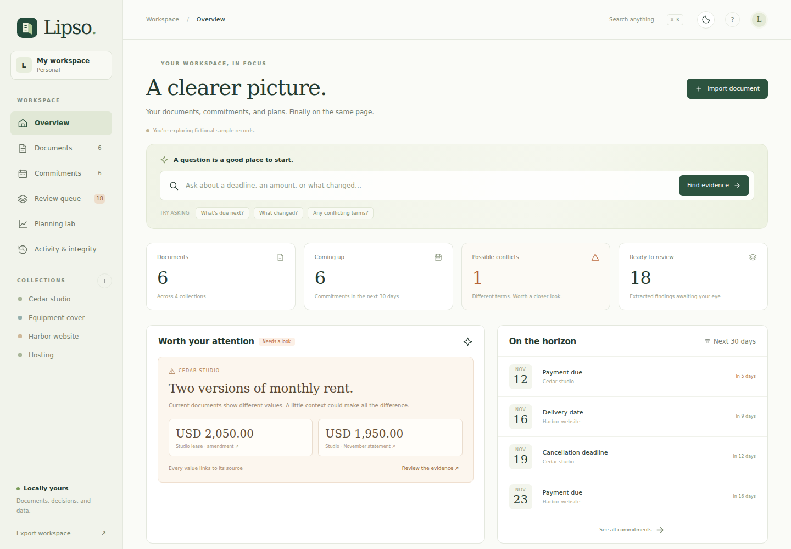
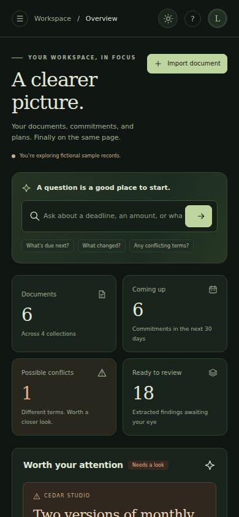
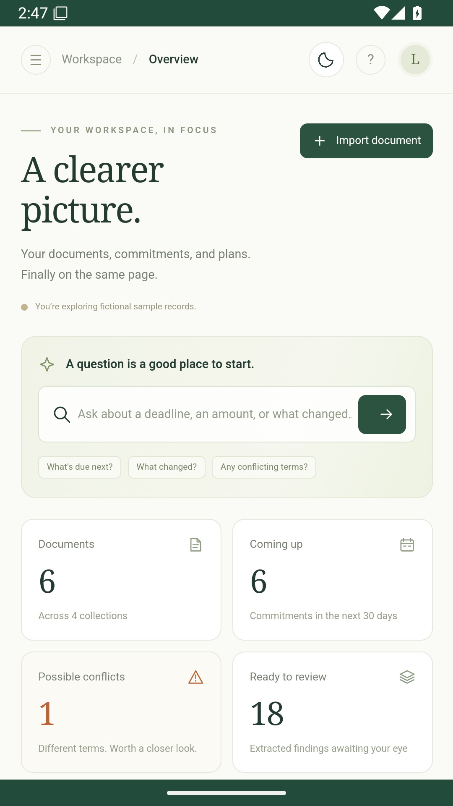
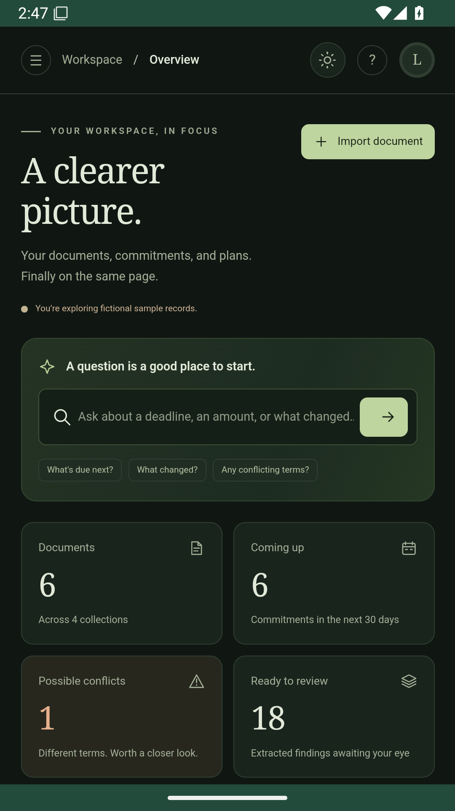
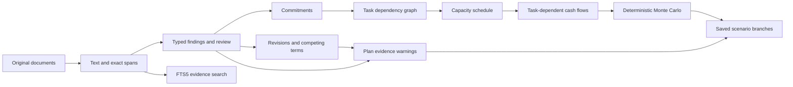

# Lipso

**A private operations workspace connecting documents, commitments, time, and money.**

A contract changes. An invoice disagrees. A delivery slips. The payment arrives late. Lipso connects those events instead of leaving them in separate document, task, and budgeting apps.

This is a working local application with a browser interface, a CLI, SQLite persistence, and executable tests. There is no account, hosted backend, external AI service, or API key. The application makes no runtime network requests beyond its own local server.

## Android

Download the APK from [GitHub Releases](https://github.com/festac-dev/Lipso/releases/latest). The Android app includes its Python backend and runs offline without Termux. It uses a separate private workspace and supports Android 7.0+ with a current Android System WebView. [Build instructions and storage details](android/README.md).

## Screenshots

These captures show the running application with fictional sample records.




| Mobile browser · light | Mobile browser · dark |
| --- | --- |
|  |  |

| Android app · light | Android app · dark |
| --- | --- |
|  |  |

Android captures come from the app running in an Android 15 emulator. [More Android screenshots](android/README.md#screenshots).

Regenerate the browser screenshots with `npm run screenshots` after installing the browser test dependencies.

## Run

Python 3.10+ with SQLite FTS5 is required. Node is only needed for browser tests, not the application.

```bash
python3 -m pip install -r requirements.txt
python3 app.py --demo
```

Open **http://127.0.0.1:3000**. `--demo` adds six clearly marked fictional documents and a connected plan, only when the document workspace is empty. Run without `--demo` for an empty workspace.

To keep samples and real documents separate:

```bash
python3 app.py --data .lipso-demo --demo
python3 app.py --data .lipso-personal --port 3001
```

In Termux, install Python with `pkg install python` first. The application has one Python dependency, `pypdf`, for PDFs. TXT, Markdown, CSV, DOCX, storage, search, scheduling, and simulation use the standard library.

## What is connected

| Capability | What works |
| --- | --- |
| Document evidence | PDF, DOCX, UTF-8 TXT, Markdown, and CSV import; original bytes preserved; exact source spans; SQLite FTS5 ranking; grounded question routing |
| Terms and revisions | Explicit replacement chains, effective dates, historical views, changed terms, competing values within a collection, human confirmation and dismissal |
| Commitments | Payment, cancellation, delivery, renewal, and expiry dates; open/completed states; source links; all-day calendar export |
| Work scheduling | Estimated effort, daily capacity, earliest starts, priorities, dependency DAGs, cycle rejection, late/unscheduled work, deadline propagation |
| Cash-flow modeling | One currency per plan, integer minor-unit accounting, recurring income and expenses, uncertainty in occurrence/amount/timing, task-dependent receipts |
| Alternate futures | Reproducible 400-path simulation, percentile chart, shortfall frequency, time/expense/payment-delay scenarios, saved branches with parent links |
| Evidence drift | Plans flag deleted, dismissed, unreviewed, conflicting, superseded, or mismatched sources—including replacements during the forecast |
| Ownership and inspection | Original downloads, structured ZIP export, plan JSON export, CLI, consistent SQLite backups, checksums, and a hash-chained audit log |

The **connection** matters: a cash receipt linked to delivery cannot arrive before the scheduled delivery date plus its payment lag. If work cannot finish inside the horizon, the receipt is excluded and explained. If an amendment changes the source of a planned recurring expense, the forecast flags that assumption rather than silently substituting a number.

## Explore the sample

1. On **Overview**, inspect the two rent amounts. Each opens the exact source line.
2. Ask **“What changed?”** to see the rent and notice-period changes between the original lease and its amendment.
3. Open **Review queue**. Confirming a finding approves the extraction; it does not declare one competing source legally authoritative.
4. Open **Commitments** and choose **Plan this** to create a task linked to its source date.
5. In **Planning lab**, inspect the dependency chain from copy approval to website delivery and its linked final payment.
6. Reduce available time or delay receipts, choose **Test this scenario**, then save a branch. The original plan remains unchanged.
7. Use **Activity & integrity** to check original content, extracted spans and values, review records, saved plans, and the audit chain.

## Import and evidence semantics

Collections define comparison scope. Put documents about the same agreement or account together. A collection containing unrelated invoices can legitimately contain different totals; these remain **possible conflicts**, not adjudicated contradictions.

Importing a file does not infer authority from its filename or recency. Specify **Replaces a document** only for an actual replacement. A revision with an effective date in the future does not suppress today's source. Effective dates are explicit import metadata; an extracted effective-date finding is not automatically adopted as authority.

The extractor recognizes ISO dates (`2027-03-15`), dates with written month names (`15 March 2027`), selected labeled amounts (`Monthly rent: NGN 450,000`), and notice periods (`30 days written notice`). It preserves ambiguous `$` amounts as `$`, not USD. Ambiguous numeric dates such as `03/04/2027` and relative terms such as “30 days after signing” are left uninterpreted. Scanned PDFs need OCR before import. Original PDF layout is not recreated; citations target extracted page text.

Questions about deadlines, changes, conflicts, and recognized terms produce structured evidence. Other questions return keyword-ranked passages. **This is deterministic extraction and retrieval, not general natural-language understanding.** A missing answer means the engine could not establish one from the supported evidence; it does not prove the document contains no relevant clause.

## Model semantics

- Monetary arithmetic uses integer hundredths of the plan's currency. Use currencies with two minor decimal places. No exchange rates or conversions are inferred.
- The forecast spans 7–180 days with at most 200 tasks and 200 cash flows. Browser simulations use 400 runs and seed 1729; CLI runs and seeds are configurable.
- Each occurrence independently uses the entered occurrence probability, a uniform delay from zero to the entered maximum, and triangular amount variation centered on the entered value.
- Monthly recurrence retains the original calendar-day anchor: January 31 → February 28/29 → March 31.
- Cash flows before the plan start are excluded; settled amounts belong in the opening balance. Flows beyond the horizon are excluded. Daily balances net same-day payments, so intraday shortages are not modeled.
- Scheduling is a preemptive, daily-capacity, deadline-first **heuristic**, with downstream deadlines propagated to predecessors. It detects cycles and reports its resulting missed deadlines; it does not prove global optimality or impossibility.
- Work estimates are deterministic. Financial risk percentages describe the proportion of simulated paths under the supplied assumptions, **not calibrated predictions**.
- Scenario sliders create explicit changes. They do not recommend borrowing, investing, or choosing one conflicting source over another.

## Command line

The same engines can be used without a browser:

```bash
python3 -m lipso import agreement.pdf --collection "Studio lease"
python3 -m lipso ask "What is the rent?" --collection "Studio lease"
python3 -m lipso ask "What changed?" --as-of 2027-01-01
python3 -m lipso list
python3 -m lipso simulate lipso-plan.json --runs 1000 --seed 42
python3 -m lipso verify
python3 -m lipso export workspace.zip
python3 -m lipso calendar commitments.ics
python3 -m lipso backup lipso-backup.sqlite3
```

Place `--data <directory>` before the subcommand to use a different workspace. New workspaces use `.lipso-data/lipso.sqlite3`. Existing `.margin-data/margin.sqlite3` workspaces are detected automatically; original files, plans, calendar identities, and theme preferences are preserved. Export and backup commands refuse to overwrite an existing file. `verify` returns a nonzero exit code on inconsistency.

ZIP exports contain originals, extracted text, findings and action states, plans, and audit events. They are portable records, not an automatic ZIP restore format. For exact recovery, use the SQLite backup command. Stop the app, create a **new empty workspace directory**, and place the backup there as `lipso.sqlite3`; then start with `--data` pointing to that directory. The older `margin.sqlite3` filename is also supported. Never replace an active database or copy a live `.sqlite3` file without its WAL; use the backup command for consistent snapshots.

## Data and trust boundaries

The server binds to `127.0.0.1`. It validates the Host and Origin headers and requires a custom header on mutation requests. It serves an explicit static-file allowlist, uses parameterized SQL and escaped document rendering, and sets a restrictive content security policy. The Android build additionally requires an app session cookie; the desktop server has no authentication. There is no remote sharing mode. Do not expose it through an internet tunnel as if it were a multiuser service.

Data is **not encrypted by this application**. Protect the device and its backups appropriately. The hash chain detects inconsistent or unlogged edits, not a malicious rewrite of the entire database. It is not a signature, an author-identity check, or proof that a claim is true. A deletion removes the original and indexed content while retaining a content-free deletion event and earlier import hashes. References in plans remain visible as missing evidence. Copies previously exported or backed up are unaffected.

## Architecture



`lipso/extract.py` handles bounded document ingestion and exact-span extraction. `store.py` owns transactional persistence, FTS, comparison, provenance, export, and integrity checks. `planner.py` is a standalone validated model. `answers.py` routes questions to evidence. `server.py` exposes local JSON APIs and static files. The browser is vanilla HTML, CSS, and JavaScript with native dialogs and SVG visualizations.

## Verification

```bash
python3 -m unittest discover -s tests -v
npm ci
npx playwright install chromium
npm run test:browser
```

Tests cover extraction from actual selectable PDF and DOCX content, Unicode spans, ambiguous dates, money precision, replacement chains, future effective dates, competing currencies, deletion and nonreused evidence IDs, persistent review/actions, injection-resistant retrieval, content/audit corruption, cash recurrence, dependency ordering and cycles, capacity conservation, delayed income, blocked receipts, deterministic sampling, isolated branches, evidence drift, HTTP boundaries, and complete desktop/mobile browser workflows. Browser tests use a disposable workspace. Set `CHROMIUM_PATH` to an existing browser executable when downloading Playwright browsers is unsuitable.

## Research and scope

[RESEARCH.md](RESEARCH.md) records the demand signals, existing alternatives, and the integration hypothesis. Neither universal novelty nor high market demand for this exact product has been established. The working system is the experiment; interviews and real-world pilots would be the next way to validate the product hypothesis.

## License

Licensed under the [Apache License 2.0](LICENSE). See [NOTICE](NOTICE) for attribution. Third-party dependencies retain their own licenses.
