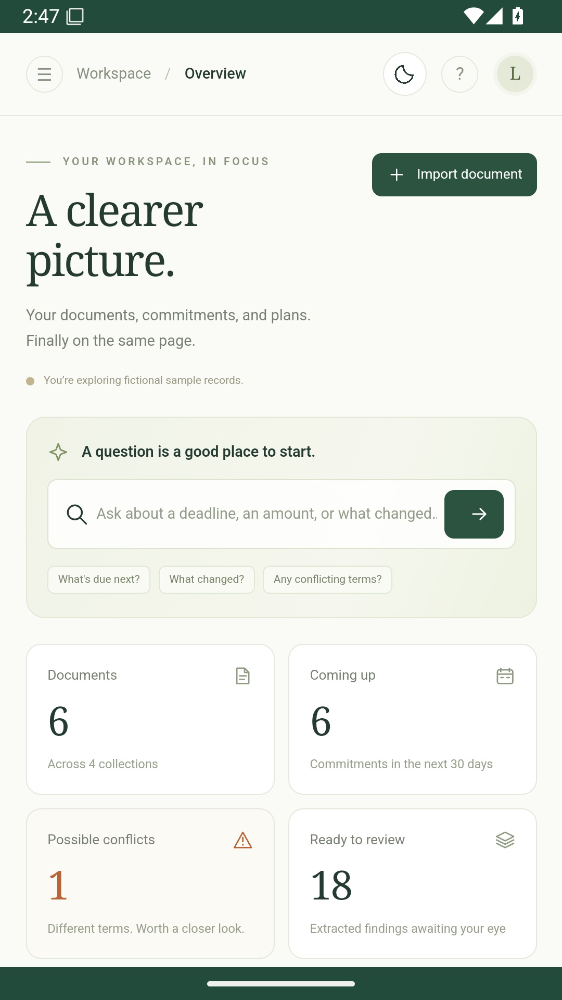
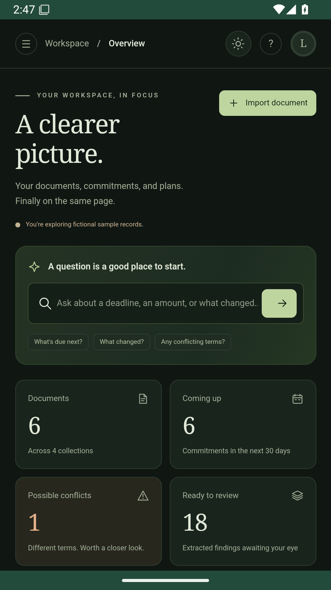
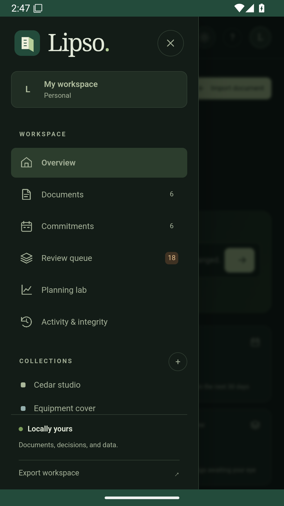
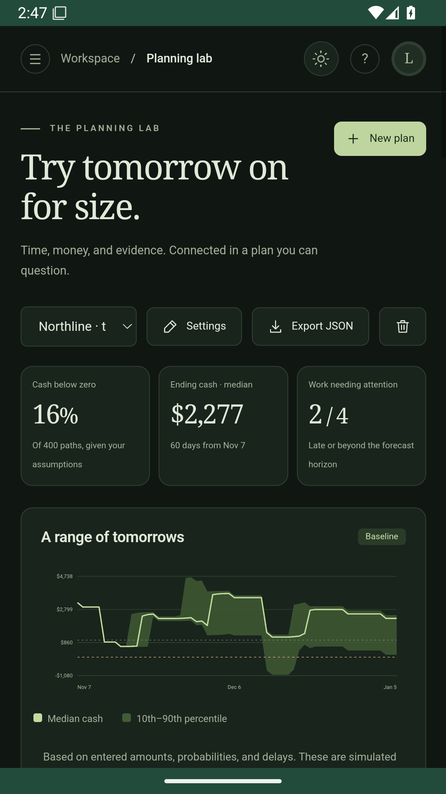

# Lipso for Android

The Android app embeds Python 3.11, SQLite FTS5, pypdf, and the same web interface as the desktop app. It works offline without Termux, an account, or a separate server. Minimum Android version: **7.0 / API 24**. The universal APK supports **arm64-v8a, armeabi-v7a, and x86_64**. Use a current Android System WebView for the interface's modern browser features.

## Build

Install JDK 17, Python 3.11, and the Android SDK (platform 35 and build tools). Set `ANDROID_HOME` or place `sdk.dir=/your/sdk/path` in an untracked `local.properties` file here.

```bash
cd android
./gradlew assembleDebug
```

The installable development APK is `app/build/outputs/apk/debug/app-debug.apk`. `assembleRelease` produces an unsigned release APK which must be signed with your own key. The [Android workflow](../.github/workflows/android.yml) builds the unsigned release, runs Python regression tests and Android lint, and exercises the app in an Android 15 emulator. Its screenshots and test reports are downloadable workflow artifacts.

```bash
./gradlew connectedDebugAndroidTest
```

Run the instrumentation check on an emulator with no existing Lipso workspace. It seeds fictional records and checks embedded Python/pypdf, authenticated HTTP access, document import, search, original downloads, ZIP/calendar export, cash-flow simulation, integrity, appearance persistence, and Android Back handling. It records screenshots from the actual Android WebView.

## Screenshots

Captured from the running Android app with fictional sample records.

| Overview · light | Overview · dark |
| --- | --- |
|  |  |

| Navigation | Planning |
| --- | --- |
|  |  |

## App behavior

- Documents and plans live in the app's private `files/workspace/lipso.sqlite3` database. The Android workspace is separate from an existing desktop or Termux workspace.
- A fresh install starts empty; **Explore a sample workspace** adds fictional records.
- Import opens the system document picker. Exports open **Save as** so you choose the destination. No broad storage permission is needed.
- The server listens on a random loopback port and requires a fresh secret, delivered through an HttpOnly WebView cookie. Host/Origin validation and mutation headers still apply. The WebView blocks remote pages and subresources; JavaScript file access and release debugging are disabled.
- Back closes a dialog or the navigation drawer first. The database and chosen theme survive reopening. The backend remains available for the life of the app process; there is no background scheduling service.
- Android automatic cloud backup is disabled. Export records you need before uninstalling: uninstalling removes the app database. Workspace ZIP exports are portable records, not a one-click restore format.
- Data is not additionally encrypted by Lipso. Android's app storage and device security provide the storage boundary.

## Signing releases

Keep the signing key outside the repository and preserve a secure backup. Future APK updates must use the same application ID and signing key, with a larger `versionCode`. Never commit keys or passwords. CI uploads unsigned release artifacts so no signing secret is needed in the repository.

Align the unsigned APK with Android SDK `zipalign`, sign it with `apksigner`, and verify the result before publishing. Publish the resulting APK and its SHA-256 checksum as GitHub release assets. Debug APKs use a different certificate and cannot update a release installation.

The initial release certificate's SHA-256 fingerprint is `a2c547012e56a3e4ce8d84005f70012663241e3123e8e7e4b78b09d63213d3fe`.

## Licenses

Lipso is Apache-2.0. The build bundles the root LICENSE/NOTICE and dependency notices under the Python assets' `licenses/` directory. Python, Chaquopy, pypdf, Android components, and their dependencies retain their own licenses. See [licenses](licenses/) and the notices packaged by each dependency.
